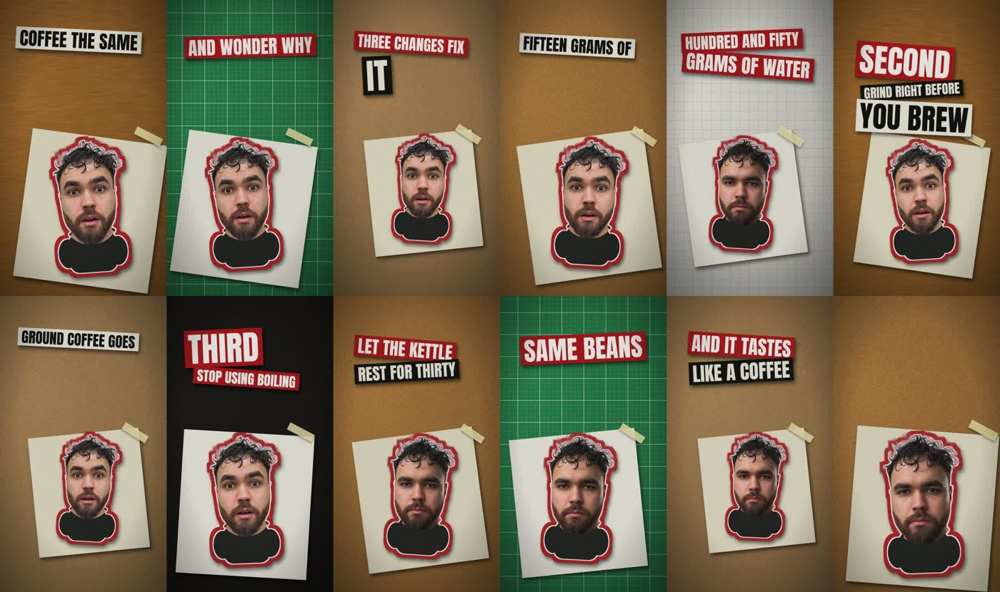

# Paper Cutout

One Claude skill that turns a script, a photo and a voice into a paper cut-out stop-motion video, built in code. It replaces the video editor and the paid project files people sell for this look. Free, MIT, no signup, no API key, nothing to connect.



**No video editor, no AI video or image model. Your face is your real photo. Nothing is posted or uploaded: the video is a file on your computer.**

## What you get

- Your face as a paper sticker on a tiny body, with a border in your colour, that talks.
- Six desks drawn in code: grid paper, cutting mat, kraft paper, felt, wood, cork.
- Word tiles that drop in on the voice, a camera that pushes or pulls on every scene, paper hits.
- A scorecard that checks the plan against the five measured rules of the look before it renders.

## Install

It needs Claude Code (it runs Python, Node.js and ffmpeg on your computer), so it does not run in the Claude.ai chat. Paste these two lines into Claude Code and it does the rest:

```
https://github.com/joshpocock/paper-cutout

Install this skill, then confirm /paper-cutout works.
```

Claude then runs `python scripts/doctor.py` (checks Python, Pillow, Node.js, ffmpeg and the font) and `python scripts/selftest.py` (draws a test face, plans and scores a short video without a render, and saves `paper/selftest/assets/selftest_frame.png`). It opens that frame and shows it to you before you make your own.

### By hand

Clone the repo into the skills folder inside your Claude config folder, as a folder named `paper-cutout`. The exact command for Windows and Mac is in [references/setup.md](references/setup.md).

You also need Python 3.8+, Pillow (`pip install pillow`), Node.js 20+ and ffmpeg. Details and fixes: [references/setup.md](references/setup.md). Tested on Windows 11. The Mac steps are the same but untested.

## Commands

| Command | The job |
| --- | --- |
| `/paper-cutout` | Asks for a photo, a script and a voice, then builds, scores and renders the video |

Or run it yourself:

```
python scripts/make.py paper/first-video --photo me.jpg --open me_open.jpg --take my_voice.m4a
```

Leave out `--take` to use a free voice made on your computer. Add `--size 1920x1080` for wide and `--accent "#C0281C"` for a different border.

## One example, start to finish

A real run on Windows 11. The script (50 words):

> Stop renaming your files by hand. Claude can do it in one line. Point it at a folder. Tell it the pattern you want. It shows you the new names first, so nothing breaks. Say yes, and four hundred files are renamed in two seconds. That is the whole trick.

Two photos of one face (mouth closed, mouth open) and a 16.2 second voice recording went in. The planner made 10 scenes, about one every 1.66 seconds, with 19 word tiles. The scorecard:

```
PASS  rule 1  poses a second                         16       want 16
PASS  rule 1  video frames a second                  30       want 30
PASS  rule 2  median scene length (s)                1.73     want 0.65 to 2.57
PASS  rule 2  scenes on a new desk (share)           1.0      want 0.9 or more
PASS  rule 2  first scene change (s)                 1.05     want 1.71 or sooner
PASS  rule 3  word tiles that animate in             0        want 0
PASS  rule 3  word overshoot (%)                     0        want 0
PASS  rule 4  scenes with a moving camera (share)    1.0      want 0.75 or more
PASS  rule 4  pull-outs (share)                      0.5      want 0.31 to 0.61
PASS  rule 4  longest still (s)                      0        want under 1.0
PASS  rule 4  cut lands before the word (frames)     2        want 1 to 3
PASS  rule 5  pose changes inside a sentence         0        want 0
PASS  rule 5  words placed outside their scene       0        want 0

13 of 13 rows pass
```

That saved run, from photo to finished 16.6 second video, took 3 minutes 49 seconds on a computer that was busy with other renders. Three more saved runs on the same Windows 11 machine, all 13 of 13: an 85-word script with a red border (31.9 s of video, 2 min 14 s), a wide 1920x1080 video (15.2 s, 2 min 0 s), and a phone photo with a real background cut out by rembg (11.5 s, 1 min 42 s). The first run on a new computer also downloads HyperFrames, a browser and the voice model once.

## The five rules

1. Sixteen poses a second, not thirty.
2. A new desk about every second and a half.
3. Words do not bounce. They appear whole.
4. The camera keeps moving, and every cut lands two frames before the word.
5. The paper person: a real face, printed big, on a tiny body, and the pose changes once per sentence.

The numbers behind each rule: [references/look-rules.md](references/look-rules.md).

## The tools

| Tool | What it does | Needs |
| --- | --- | --- |
| `scripts/make.py` | runs every step in order | standard library |
| `scripts/person.py` | cuts you out, builds the sticker and the two mouths | Pillow, rembg for photos with a background |
| `scripts/desks.py` | draws the six desks, paper fibre and grain | Pillow |
| `scripts/voice.py` | your recording, or a free local voice | ffmpeg, or Node.js for the free voice |
| `scripts/words.py` | when each word is spoken | standard library |
| `scripts/plan.py` | one scene per phrase, written to `scenes.json` | standard library |
| `scripts/score.py` | the scorecard | standard library |
| `scripts/build.py` | the page that gets rendered, and the paper hits | standard library, ffmpeg |
| `scripts/render.py` | the mp4 | Node.js, ffmpeg |
| `scripts/doctor.py` | checks this computer has what it needs | standard library |
| `scripts/selftest.py` | a full test run with a drawn face, no render | Pillow |

Tests: `python -m unittest discover -s tests`.

## Where it is weak

- Word timing is an estimate from word length unless you give it a transcript with word times (`words.py --from`).
- The mouth is a swap between your two whole photos, so the two need the same framing or the face jumps.
- Use a head-and-shoulders photo. A photo that shows your whole upper body sits oddly on the tiny paper body.
- It is built for short scripts: 30 to 120 words, 15 to 45 seconds.
- The desks are drawn in code. It does not make props or hands; bring your own images if you want them.
- The scorecard checks the plan, not the pixels. Always look at the frames.

## The fine print

- Use your own face, or a character you made or own. Do not put another real person's head on a paper body.
- The scorecard checks the plan, not the pixels. Look at the frames before you post.
- Bring your own music file if you want music. None is included.
- The font is Anton, under the SIL Open Font License. The code is MIT.
- Your photos, voice and video stay on your computer.

Made by Josh Pocock. More free skills and the step-by-step page: https://strideaiacademy.com/r/paper-cutout
